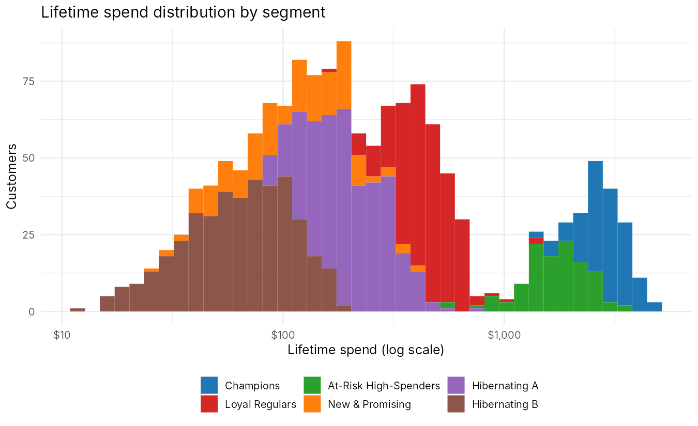
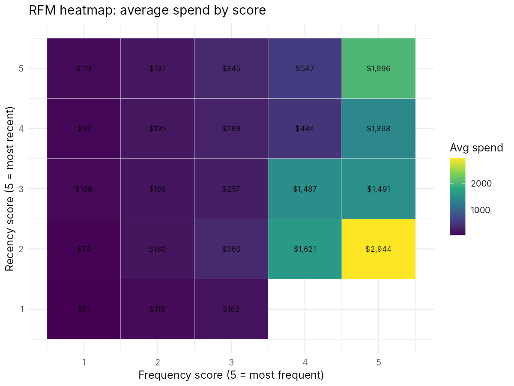
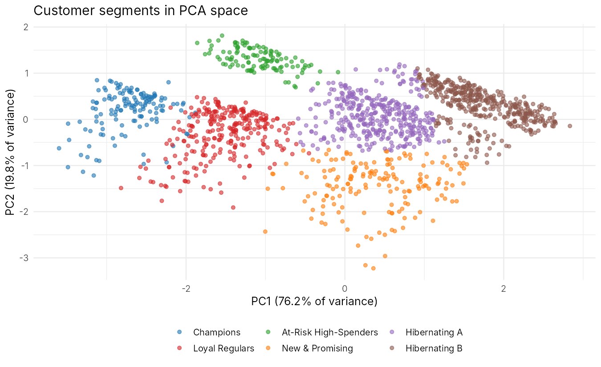
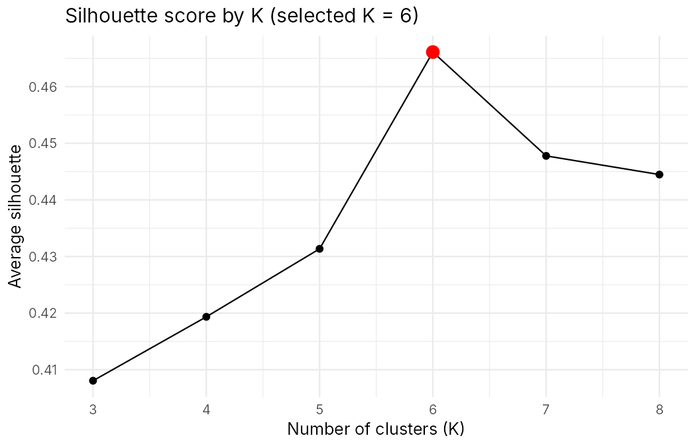
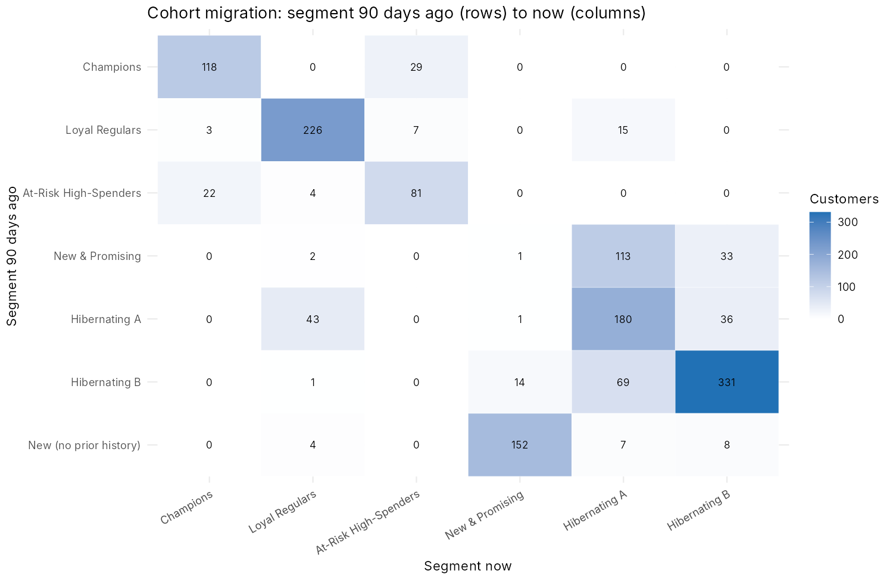

# Segmentrix-R
by BOGIATZIS ALEXANDROS
Customer segmentation, RFM analysis and lifecycle analytics in R + Shiny.

## Results preview

Charts generated from the synthetic demo data (regenerate with `source("export_figures.R")`):

| Spend distribution | RFM heatmap |
|---|---|
|  |  |

| Customer clusters (PCA) | Choosing K |
|---|---|
|  |  |

**Cohort migration:**



## 1. One-time setup

1. Install **R** (4.1 or newer): https://cran.r-project.org
2. Install **RStudio Desktop** (the editor everyone uses for R): https://posit.co/download/rstudio-desktop/
3. In RStudio: `File > Open File...` and pick `install_packages.R`, then click **Source** (top right of the editor). Wait until it finishes.

## 2. Run the app

1. `File > Open Project / Open File` and open `app.R`.
2. Click **Run App** (green triangle, top right of the editor).
3. The app opens with synthetic demo data. Press **Run analysis** after changing anything in the sidebar.

Or from the R console (working directory = project folder): `shiny::runApp()`

## 3. Folder structure

```
segmentrix-r/
├── app.R                  UI + server: connects everything
├── install_packages.R     run once
├── README.md
└── R/                     Shiny auto-loads every file here before app.R
    ├── synthetic_data.R   fake transactions (so the app runs with no files)
    ├── etl.R              load, validate, clean, compute RFM, RFM scores
    ├── clustering.R       log + scale, find best K, K-means, naming, PCA
    ├── migration.R        compare two snapshots in time -> migration vectors
    └── insights.R         churn risk, segment KPIs, playbook, auto-written text
```

## 4. Using your own CSV
Choose **Upload my CSV** in the sidebar. Required columns (names must match exactly):
| Column | Example |
|---|---|
| CustomerID | C00017 |
| InvoiceDate | 2026-03-31 (ISO format preferred) |
| TransactionID | T0004521 |
| OrderValue | 59.90 |
| ProductCategory | Fashion (optional) |

One row per order, or one row per order line (several rows can share a TransactionID;
Frequency counts distinct TransactionIDs and Monetary sums OrderValue).

To create a sample file to test uploading, run in the R console:
```r
source("R/synthetic_data.R")
data.table::fwrite(generate_synthetic_transactions(2000), "sample_transactions.csv")
```
## 5. How the analysis works
| Step | What happens | Where |
|---|---|---|
| Clean | Remove rows with missing values, refunds / zero values, exact duplicates | `clean_transactions()` |
| RFM | Recency = days since last order. Frequency = distinct orders. Monetary = total spend (AOV = Monetary / Frequency) | `compute_rfm()` |
| Scale | `log1p()` of each metric, then standardise to mean 0 / sd 1 | `build_feature_matrix()` |
| Choose K | K-means for K = 3..8; pick best average silhouette (or the elbow) | `evaluate_k()`, `select_k()` |
| Cluster | Final K-means (50 random starts) | `fit_segments()` |
| Name | Cluster centres are compared with the average customer, rules assign names such as Champions / At-Risk High-Spenders / Hibernating | `name_segments()` |
| Migration | RFM is calculated "as of" today and "as of" N days ago; both are assigned to the same clusters; the pair is the migration vector | `build_migration()` |
| Insights | Churn probability, revenue share, recommended action, written summary | `insights.R` |

### Design decisions worth knowing
* **K starts at 3**, not 2. Silhouette often favours K = 2 ("good vs bad"), which is
  too coarse for marketing. Change `k_range` in `fit_segments()` if you disagree.
* **Migration uses snapshots**, not two isolated windows. RFM computed inside a 90-day window
  alone would cap Recency at 90 and lose lifetime Frequency/Monetary. Snapshots keep features
  comparable and let one model score both points in time.
* **Churn risk is a transparent heuristic** (how overdue a customer is relative to their own
  buying rhythm), not a trained model. To upgrade it, train a logistic regression with
  `glm()` on the snapshot from N days ago, with "did not buy afterwards" as the label.
* **The "AI" insight engine is rule-based**: templates plus business rules. Deterministic,
  free and explainable. An LLM call could replace the text-building later.
* **GMM** (Gaussian mixture) is not included. To add it, install `mclust`, run
  `mclust::Mclust(x, G = 3:8)` inside `fit_segments()` and use `$classification`.

## 6. Troubleshooting
| Problem | Fix |
| `there is no package called 'xyz'` | Run `install.packages("xyz")` |
| `could not find function "nav_panel"` | bslib is too old: `install.packages("bslib")` |
| `unexpected '>'` | R older than 4.1: update R |
| Upload shows a red message | The message names the missing column |
| Slow with very large files | Silhouette is sampled to 3000 rows; PCA plot to 5000 points |

